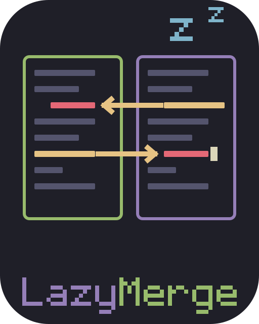

<h1 align="center">
  
</h1>

<p align="center">
  Compare and merge two folders side by side, with vim-style keys.<br>
  A Rust terminal app and a self-contained HTML app. Both work locally, without a server.
</p>

Current version: **0.1.1** for both the terminal and browser apps.

## Terminal version

The Rust TUI centers the custom violet-and-green ASCII wordmark at the top, with its size calculated from [`src/logo.txt`](src/logo.txt). It uses the HTML app's Kanagawa colours and layout: a shared folder tree above aligned, side-by-side file panes. Smaller terminals get a centered compact header. The version stays visible below the wordmark.

- Compare folders, expand or collapse their trees, search file names, and filter included or excluded files.
- Distinguish changed files, files present on one side, minor differences (line endings, BOM or ignored whitespace), identical files and read errors.
- Navigate differing sections, highlight changed characters, select lines, merge in either direction, edit text and undo. Edits stay in memory until saved.
- Copy a file or a folder's differing/missing files as raw bytes after confirmation. Copies write to disk immediately; they never delete files.
- Refresh the folder overview and clean open files when files change externally; preserve staged edits and ask before overwriting changed files.
- Highlight source text in common programming and configuration languages, including multiline comments and strings.
- Configure colours, keys, labels, filters and layout with Lua.

### Install and start

Linux and macOS (Intel/x64 and ARM64):

```sh
curl -fsSL https://raw.githubusercontent.com/he-d/lazymerge/main/install.sh | sh
```

Windows (PowerShell, x64 and ARM64):

```powershell
powershell -ExecutionPolicy Bypass -c "irm https://raw.githubusercontent.com/he-d/lazymerge/main/install.ps1 | iex"
```

The installers download a prebuilt binary from [GitHub Releases](https://github.com/he-d/lazymerge/releases), verify its SHA-256 checksum, and install for your user account. No Rust toolchain, Lua installation or administrator access is needed. Rerun the same command to update.

Linux/macOS installs to `~/.local/bin` by default; the installer prints any `PATH` setup needed. Windows installs to `%LOCALAPPDATA%\LazyMerge\bin` and updates your user `PATH`; open a new terminal afterward. Set `LAZYMERGE_INSTALL_DIR` to use another directory or `LAZYMERGE_VERSION=0.1.1` to select a release.

The download commands require the installer files on `main` and published release binaries; see [Publishing a release](#publishing-a-release). To install directly from a local checkout, install a Rust toolchain and a C compiler, then run:

```sh
cargo install --path . --locked
```

This installs the `lazymerge` command in Cargo's binary directory, normally `~/.cargo/bin`; make sure that directory is on your `PATH`. Lua is built into the executable, so no Lua runtime installation is needed.

```sh
lazymerge
lazymerge "path to left folder" "path to right folder"
lazymerge -l /path/to/left -r /path/to/right
```

Without arguments, LazyMerge asks for the left folder, then the right folder; press `Enter` to accept each path. Supplying both folders skips these prompts. Supplying just one folder asks only for the missing side.

Path fields support `Tab` / `Shift+Tab` directory completion, relative and absolute paths, `~/`, spaces and quoted paths. Repeated completion cycles candidates. Completion also works inside a path and closes unfinished quotes. Press `p` to choose another folder pair later.

Press `q` outside text fields to quit, or `Ctrl+C` from anywhere. LazyMerge always asks before closing, including when there are no unsaved edits. Confirmations start on **No**: `Enter` cancels, `y` accepts, and `n` / `Esc` cancels; `Tab` or left/right changes the selected choice. In text fields, `q` is ordinary input.

### Terminal keys

These are the defaults; `?` opens help showing your configured bindings. `Tab` switches focus between the folder tree and an open file.

| Key | Context | Action |
|---|---|---|
| `j` / `↓`, `k` / `↑` | Both panes | Next / previous row |
| `PageDown` / `PageUp` | Both panes | Move a page |
| `Enter` | Tree | Open a file or toggle a folder |
| `l` / `→`, `h` / `←` | Tree | Expand / collapse a folder, or move to its parent |
| `e` / `c` | Tree | Expand / collapse all folders |
| `a` / `d` | Tree | Show all files / differences only; minor differences are hidden with identical files |
| `/` | Both panes | Find a file name or text in both file versions |
| `f` / `Shift+f` | Anywhere outside text fields | Edit include / exclude patterns; `Enter` applies |
| `w` | Anywhere outside text fields | Toggle ignore whitespace |
| `p` | Anywhere outside text fields | Choose folders with path completion |
| `r` | Tree / diff | Rescan folders / reload both open files; asks before discarding edits |
| `Alt+l` / `Alt+h` | Tree | Copy the selected file or folder to the right / left, after confirmation |
| `gg` / `G`, `Home` / `End` | Diff | Start / end of file |
| `Ctrl+d` / `Ctrl+u` | Diff | Move half a page down / up |
| `n` / `N` | Diff | Next / previous differing section |
| `h` / `←`, `l` / `→` | Diff | Scroll horizontally |
| `v` | Diff | Start / finish selecting rows; moving extends the selection |
| `L` / `H` | Diff | Merge selected rows, or the current section, to the right / left |
| `Alt+l` / `Alt+h` | Diff | Stage the whole file on the right / left, including its final newline |
| `i` / `I` | Diff | Edit the left / right selection, section or line |
| `u` | Diff | Undo an edit or merge |
| `Ctrl+S` | Open file, including editor | Save the left side |
| `Ctrl+Alt+s` | Open file, including editor | Save the right side |
| `Alt+s` / `Alt+Shift+s` | Open file, including editor | Save both sides |
| `Alt+Enter` | Editor | Apply the edit to the staged buffer |
| `Esc` | Diff | Clear a selection, otherwise close the file; asks before discarding edits |
| `q` / `Ctrl+C` | Outside text fields / anywhere | Ask before quitting |

In file search, `Enter` / `Shift+Enter` jumps to the next / previous match; `Esc` returns to the file. In the editor, `Enter` inserts a line, `Tab` inserts spaces, `Alt+Enter` applies the edit and `Esc` cancels it. `Ctrl+Enter` also applies when the terminal delivers it; the app cannot intercept shortcuts consumed by the desktop or terminal. The Lua `keys.accept_edit` setting can change the primary shortcut. A save shortcut applies the editor first. Applying an edit stages it; saving writes it to disk. `Alt+s` always saves both sides of an open file, including with older Lua bindings.

With the mouse, click a folder to toggle it or a file to open it. Scroll over either pane; Shift+wheel scrolls the diff horizontally. Click or drag across diff rows to select them, Shift+click extends the selection, and double-click edits that side. Click the overview strip to jump between sections or the middle ←/→ arrows to stage a section merge. Confirmation buttons are clickable.

External changes are checked every `poll_seconds` (3 seconds by default) and when the terminal regains focus. Clean file views reload automatically; unsaved edits and open editors are kept. A persistent **Files changed** notice has a Kanagawa `surimiOrange` border (`#FFA066`), configurable as `colors.warning`. The overview discovers changed, added and deleted files without pressing Reload. The browser app also outlines its file-change notice in orange.

Syntax colours cover XML/HTML, Rust, C-like languages, JavaScript/TypeScript, Python, JSON, TOML, YAML, Lua, shell scripts, SQL and Markdown. Multiline comments and strings retain their colours across rows. The lightweight lexer uses plain text for individual lines larger than 256 KiB to keep generated files responsive.

Include/exclude patterns are case-insensitive and separated by semicolons or commas, for example `*.rs;*.json`. The default excludes are `.git;.vs;node_modules;target`. Settings changed inside the app last for that session; edit the Lua file to make them persistent.

### Lua configuration

LazyMerge reads `$XDG_CONFIG_HOME/lazymerge/config.lua`, or `~/.config/lazymerge/config.lua` when `XDG_CONFIG_HOME` is unset. An absent default file uses the built-in settings. Use an explicit file with:

```sh
lazymerge --config /path/to/config.lua /left /right
```

On Windows, the default is `%APPDATA%\lazymerge\config.lua`; `XDG_CONFIG_HOME` still takes precedence. Home paths such as `~\projects` work there as well.

The config is executable Lua and must return a table. Omitted settings, colours and key bindings retain their defaults:

```lua
return {
  show_logo = true,
  left_label = "Release",
  right_label = "Main",
  tree_percent = 35,
  ignore_whitespace = false,
  include = "*.rs;*.json",
  colors = { logo_lazy = "#957FB8", logo_merge = "#98BB6C" },
  keys = { quit = "ctrl+q" },
}
```

See [`config.example.lua`](config.example.lua) for all settings, colour names and configurable actions. Bindings support characters, named keys and modifiers such as `ctrl+q`, `alt+l` or `f2`; letter case matters. Set a binding to `""` to disable it. Unknown settings, invalid colours and duplicate bindings produce an error. Quit confirmation always remains enabled.

`lazymerge --print-config` prints the complete default Lua configuration and exits without writing a file. After creating the config directory, you can save it with `lazymerge --print-config > ~/.config/lazymerge/config.lua` (adjust the path when using `XDG_CONFIG_HOME`). Setting `show_logo = false` leaves the compact LazyMerge header visible.

### File handling and development

Saving preserves a UTF-8 target's BOM, predominant line ending and final-newline state. Section/whole-file merges reaching the end transfer the source's final-newline state; newly created targets inherit the source's format. Editing a file with mixed line endings normalizes it to its predominant line ending. UTF-16 and Windows-1252 can be compared and used as text sources, but cannot be edited or saved in their original encoding. Binary files can be copied from the tree. Raw copies preserve the original bytes.

The two roots must be separate existing directories; identical or nested roots are rejected. Symlinks and file/directory type conflicts appear as errors and are not traversed or overwritten. Saves use temporary files and atomic replacement, and both saves and copies check for external changes before writing. Writes are atomic per file; a folder copy can stop partway through if a later file cannot be written.

The terminal app lives in [`src/`](src), using Ratatui, a vendored Lua interpreter and the same comparison/merge concepts as the browser app. To build and check it:

```sh
cargo build --release --locked
cargo test --locked
cargo clippy --locked --all-targets -- -D warnings
cargo fmt --check
```

On Unix, `cargo build --locked` followed by `python3 tests/pty_smoke.py` exercises startup and path completion, both command-line path forms, the edit/save shortcuts, CRLF preservation, external changes and save conflicts, mouse clicks, focus changes and quit confirmation in a real terminal session.

Run `python3 tests/test_install.py` for the Unix installer's offline integration tests. Windows installer tests run with `powershell -ExecutionPolicy Bypass -File tests/test_install.ps1`.

### Publishing a release

The [release workflow](.github/workflows/release.yml) tests and builds native x64/ARM64 binaries for Linux, macOS and Windows. It also runs the terminal smoke tests on Linux and macOS. Linux builds use musl. Pushing a version tag matching both apps, such as `v0.1.1`, publishes the archives, `SHA256SUMS`, browser HTML, installers and example config to GitHub Releases. Installer updates check these release checksums before replacing an existing executable.

Publish the source and installer scripts on `main` before pushing the release tag. Running the workflow manually builds and checks the packages without publishing a release. The public one-line commands become usable after those files and release assets are published.

## Browser version

The browser app is one self-contained HTML file: no installation, build step or server. The following sections describe its controls and keyboard shortcuts.

### Features

- **Folder compare**: both folders as one tree, every file marked as different, only left, only right, nearly identical (only line endings or BOM differ) or identical. Show all files or only the differences, find files by name, filter by pattern.
- **File compare**: the two versions side by side with aligned lines, changed characters highlighted within a line, an overview strip of all differences, and syntax colours for XML-like files.
- **Merge**: take over a section, a few marked lines or the whole file to the other side, edit lines in place, undo every step. Nothing is written until you save.
- **Copy files and folders** from one side to the other (with a confirmation). LazyMerge never deletes anything.
- **Keeps your files as they are**: encoding (UTF-8 with or without BOM) and line endings (CRLF / LF) of the saved file stay unchanged.
- **Notices changes made elsewhere**: if an open file is changed by another program, the page shows it and asks before overwriting.
- **Keyboard first**: vim-style navigation in the folder tree and in the file compare, find with `/`.

### Getting started

1. Download [`lazymerge.html`](lazymerge.html).
2. Open it in **Microsoft Edge** or **Google Chrome** on the desktop, e.g. by double-clicking it. Nothing to install.
3. Click **Left folder…** and **Right folder…**. The browser asks once per folder whether the page may read and write it.

LazyMerge needs the [File System Access API](https://developer.mozilla.org/en-US/docs/Web/API/Window/showDirectoryPicker) of the browser to work with local folders. In a browser without it, the page says so.

### Your files stay on your machine

The page contains no network code: it loads nothing from the internet and sends nothing anywhere. It reads the two folders you picked and writes to them only when you copy or save.

What the browser keeps for the page:

- the settings (filters, labels, the size of the panes) in its local storage,
- the two picked folders, so that the last pair is compared again when you open the page later. If the browser no longer grants access (e.g. after a restart), **Reload** asks for it once more.

**Clear** (`Alt+C`) forgets both folders and the labels.

### Folder compare

| Mark | Meaning |
|---|---|
| red `≠` | different |
| violet | only on one side |
| blue `≈` | only line endings, BOM or (with *Ignore whitespace*) spaces differ |
| grey | identical |

- **All** / **Differences** shows all files or only those that differ. **Expand** / **Collapse** opens or closes all folders; after the first compare the folders with differences are open.
- **Find** (`/`) shows only the files whose name contains the text, while you type (not case-sensitive), with their folders opened.
- **Filter** (e.g. `*.rs;*.json`) and **Exclude** (default `.git;.vs;node_modules`) decide which files are read; press Enter to apply. **Ignore whitespace** treats lines that differ only in spaces or tabs as equal.
- **Copy →** / **← Copy** copies the selected file to the other side, or for a folder all files below it that differ or are missing there. You are asked first; existing files are overwritten.
- The label fields name the two sides in the headers, e.g. "Release" and "Main".

### File compare

Click a file or press Enter to open it below the tree (the divider can be dragged).

- The strip on the far left shows all differing sections; click to jump.
- The arrows in the middle (or **Section →** / **← Section**, `L` / `H`) take a section over to the other side; the cursor then moves on to the next section.
- **All →** / **← All** (`Alt+l` / `Alt+h`) take over the whole file, including the line break at the end of the file. A section or marked lines that reach the end of both files take it along as well.
- Mark whole lines by dragging with the mouse, with **Shift+click** or with `v`. With lines marked, the section commands and the editor work on those lines only, so you can take over part of a section.
- Double-click a line or use **✎ Left** / **✎ Right** to edit it (inside a differing section: the whole section of that side). **Apply** takes the text, **Cancel** discards it, an empty text removes the lines.
- **Undo** reverts every change. **Save left** / **Save right** write to disk and turn green while that side has unsaved changes.
- If an open file changes on disk, **Reload** turns orange (checked every 3 seconds and when you come back to the window).
- **Find** (`/`) searches both files while you type and marks every place found.

Files in other encodings (e.g. Windows-1252, UTF-16) can be compared but not edited, because the browser can only write UTF-8. Binary files can only be copied as a whole.

### Keyboard shortcuts

Folder compare (right after loading and while no file is open the keys work anywhere except in text fields; with a file open, click into the tree first):

| Key | Action |
|---|---|
| `j` / `↓`, `k` / `↑` | next / previous row |
| `l` / `→` | open folder |
| `h` / `←` | close folder, otherwise go to the parent folder |
| `Enter` | open file, open or close folder |
| `r` | read both folders again (**Reload**) |
| `e` / `c` | open / close all folders (**Expand** / **Collapse**) |
| `a` / `d` | all files / differences only (**All** / **Differences**) |
| `/` | **Find** by file name; in the field `Enter` goes to the first file found, `Esc` clears the search |
| `Alt+l` / `Alt+h` | copy the selected file or folder to the right / to the left (like **Copy →** / **← Copy**, asks first; only while no file is open) |
| `Alt+C` | **Clear** (asks first; works anywhere on the page) |

File compare:

| Key | Action |
|---|---|
| `j` / `↓`, `k` / `↑` | cursor row down / up; 7 rows stay visible above and below it (like vim `scrolloff`) |
| `gg` / `G` | start / end of the file |
| `zz` | cursor row to the middle |
| `Ctrl+d` / `Ctrl+u` | half a page down / up, then the cursor row in the middle |
| `n` / `N` | next / previous differing section |
| `/` | **Find** in both files; in the field `Enter` / `Shift+Enter` next / previous place, `Esc` back to the lines with the cursor on it |
| `h` / `←`, `l` / `→` | scroll sideways |
| `v` | mark lines from the cursor row on, moving extends the marking; `v` again ends it |
| `L` / `H` | take the marked lines, otherwise the section under the cursor, over to the right / to the left |
| `Alt+l` / `Alt+h` | take the whole file over to the right / to the left (like **All →** / **← All**) |
| `i` / `I` | edit on the left / right (marked lines, otherwise the line or the whole section) |
| `y` / `Y` | copy the marked lines of the left / right side to the clipboard |
| `Ctrl+C` | copy the marked lines of the side where you marked them with the mouse |
| `u` | undo |
| `r` | read both files again |
| `Alt+S` | save both sides (also while editing) |
| `Esc` | remove the marking, otherwise close the file compare |

Editor: `Esc` or `Ctrl+Enter` takes the text and returns to the keys above (a second `Esc` closes the file compare), `Tab` inserts four spaces.

`Ctrl+S` and `Ctrl+Z` stay with the browser on purpose. Taking over sections never writes to disk, so a wrong key press is undone with `u`.

### How it is built

Everything lives in `lazymerge.html`: the styles, a script with the pure logic (line diff, encodings, syntax colours, folder compare) and a script for the page. There are no dependencies and no build step; the page works offline.

Colours: the Wave palette of [Kanagawa](https://github.com/rebelot/kanagawa.nvim).

## License

[MIT](LICENSE)
